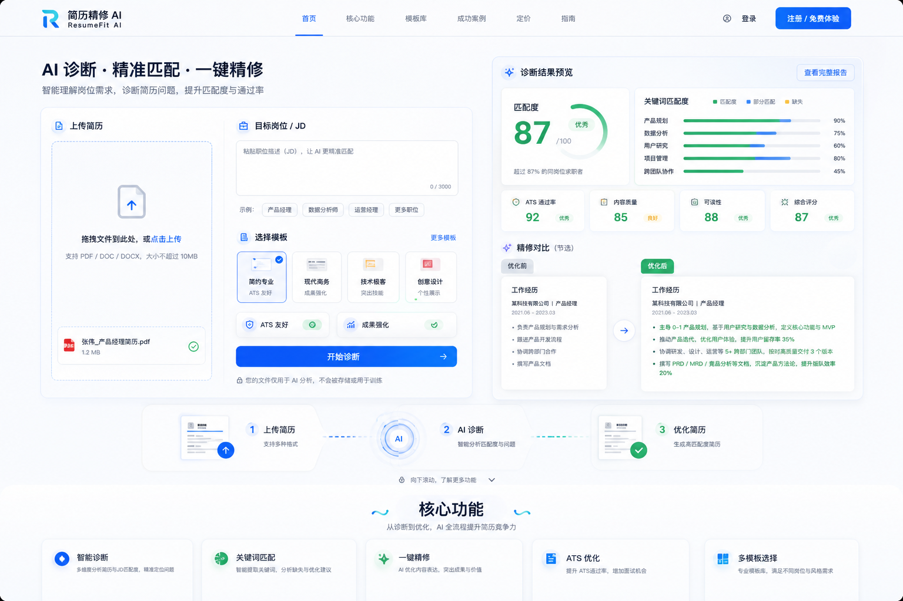

# 简历精修 AI / ResumeFit AI V1 产品设计文档

日期：2026-07-28

状态：产品设计稿，待实现前确认

视觉参考图：

## 1. 产品定位

**中文名：**简历精修 AI

**英文名：**ResumeFit AI

**一句话定位：**上传简历和目标岗位，AI 自动诊断匹配度，并生成更适合投递的优化版简历。

**目标用户：**

- 正在准备校招、实习、社招跳槽的求职者。
- 想根据不同 JD 快速改简历的人。
- 对 ATS、关键词匹配、简历表达不熟悉的人。
- 需要中文大厂风格、产品经理、AI 产品经理、技术岗等定向简历改写的人。

**核心价值：**

- 帮用户快速看懂“这份简历和目标岗位差在哪里”。
- 把模糊表达改成更具体、更有岗位匹配度的表达。
- 通过模板和风格按钮，让用户先选择想要的简历方向，再生成结果。
- 在优化时保留真实经历，不编造事实，把需要确认的数据单独列出。

## 2. 首页设计目标

首页第一屏不做传统营销页，直接做成可操作的简历诊断入口，学习 Resume Worded 的“上传即开始”体验。

首屏必须让用户立刻知道三件事：

- 我可以上传简历。
- 我可以输入 JD 或岗位方向。
- 我会得到匹配分和可执行的修改结果。

页面氛围需要有“智能感”，但不做空泛科技风。智能感来自真实的分析界面、分数、关键词匹配、改写前后对比、流程动效，而不是大面积渐变、抽象光效或装饰性图形。

## 3. 首页信息架构

首页从上到下建议分为 6 个部分：

1. **Hero 上传诊断区**
   用户上传简历、填写岗位/JD、选择模板和风格，并点击开始诊断。

2. **动图演示区**
   展示从“上传简历”到“AI 诊断”再到“生成优化版简历”的三步动画。

3. **核心功能介绍**
   介绍智能诊断、JD 匹配、关键词缺口、ATS 优化、一键改写、多模板选择。

4. **模板与风格选择**
   展示校招、社招、产品经理、AI 产品经理、技术岗、运营/市场等模板，以及保守事实型、ATS 友好型、成果强化型、中文大厂型等风格。

5. **隐私与事实校验说明**
   明确用户上传的简历不用于训练，V1 不存储原始简历/JD，AI 推断的数据会要求用户确认。

6. **FAQ 与再次 CTA**
   回答能否上传 PDF、是否支持中文、是否会编造经历、如何根据 JD 优化等问题，并引导回到上传区。

## 4. Hero 设计

Hero 是首页的核心产品界面，不是纯文案横幅。

### 左侧：上传和输入区

左侧区域包含：

- 简历上传框。
- 支持格式提示：PDF、DOCX、图片，最大 10MB。
- 粘贴简历文本入口。
- 目标岗位输入框。
- JD 文本框。
- 模板选择按钮。
- 风格选择按钮。
- “开始诊断”主按钮。

默认按钮文案：

- 上传简历
- 目标岗位 / JD
- 选择模板
- ATS 友好
- 成果强化
- 开始诊断

### 右侧：诊断结果预览

右侧展示一个结果预览面板，让用户在上传前就知道会得到什么：

- 匹配度分数，例如 87 / 100。
- ATS 通过率。
- 关键词匹配度。
- 内容质量。
- 可读性。
- “优化前 / 优化后”简历片段对比。
- 缺失关键词和能力标签。

这些内容可以用示例数据展示，但不能包装成真实用户案例。

## 5. 动图演示设计

首页需要加入简历诊断和修改的动图演示。实现时优先做成网页内动画，而不是依赖一个真实 GIF 文件。

推荐方案：

- 在 Hero 下方放一条横向三步流程动画。
- 三个状态依次高亮：
  1. 上传简历。
  2. AI 诊断匹配度。
  3. 生成优化版简历。
- 中间用流动虚线、扫描线、进度环、文档卡片位移来表达智能处理过程。
- 右侧或下方展示“优化前 / 优化后”的文案切换动画。

动画不应太重，首屏加载时不能明显拖慢页面。实现时可以用 CSS transition、Framer Motion 或现有 motion 依赖完成。

## 6. 滚动动画设计

用户上下滑动页面时要有丝滑感，但不能牺牲可读性。

动效原则：

- 首屏进入时，上传框、诊断预览、流程演示按层级轻微上浮进入。
- 下滑时，功能卡片逐个淡入和轻微位移。
- 诊断分数可以在进入视口时从 0 递增到示例分数。
- 关键词匹配条可以在进入视口时从左到右展开。
- 改写前后对比可以使用滑动或交叉淡入。
- 页面整体不能有大幅视差，避免眩晕。
- 必须尊重用户系统的 `prefers-reduced-motion`，减少动效。

适合的动效：

- `opacity + translateY`
- 轻微 `scale`
- 进度条宽度展开
- 数字递增
- tab/模板选择的高亮滑块

不适合的动效：

- 大面积旋转。
- 过度粒子效果。
- 复杂 3D 翻转。
- 背景漂浮光球。
- 每个卡片都持续循环动。

## 7. 视觉风格

整体风格关键词：

- 智能。
- 专业。
- 清爽。
- 值得信任。
- 有产品工具感。

配色建议：

- 背景：白色、浅灰、轻微冷色。
- 主色：蓝色或蓝青色，用于主按钮、上传状态、智能处理线。
- 成功色：绿色，用于匹配分、已完成、优势项。
- 警示色：琥珀色，用于缺失关键词、需确认事实。
- 深色文字：用于标题和重要指标。

避免：

- 全页面紫蓝渐变。
- 过暗的黑色科技风。
- 大量抽象光球。
- 过多卡片堆叠。
- 与简历/求职无关的装饰图。

## 8. 模板和风格设计

用户需要先选简历模板，再生成对应简历。

### 简历模板

- 校招 / 应届生：突出教育、实习、项目、竞赛、校园经历。
- 社招通用：突出职业摘要、核心优势、工作经历和成果。
- 产品经理：突出需求分析、数据指标、项目推进、商业结果。
- AI 产品经理：突出 AI 产品理解、Agent/Workflow、模型应用、工程协作，但不编造 AI 经历。
- 技术 / 研发：突出技术栈、系统贡献、复杂度、性能和稳定性。
- 运营 / 市场：突出增长、内容、渠道、转化和用户洞察。

### 修改风格

- 保守事实型：只优化表达，不新增未经证实的信息。
- ATS 友好型：强化关键词、结构和机器可读性。
- 成果强化型：把弱表达改成背景、动作、结果。
- 中文大厂型：表达更职业化，突出复杂项目和跨团队推进。

按钮交互：

- 模板用卡片式按钮，展示名称、适合人群、简短说明。
- 风格用 segmented control 或 pill buttons。
- 选中态要明确，但不要花哨。

## 9. 诊断结果设计

诊断结果需要让用户一眼看懂“哪里不匹配”。

结果模块包含：

- 总匹配分。
- 匹配等级：低 / 中 / 高。
- 简历优势。
- Top 3 问题。
- JD 关键词缺口。
- 各模块问题：个人摘要、教育、经历、项目、技能。
- 一条示例改写。
- 登录或继续优化 CTA。

分数解释：

- 0-59：匹配较弱，需要补强经历表达和关键词。
- 60-79：具备基础匹配度，但需要改写重点和结构。
- 80-100：匹配度较好，可继续精修表达和投递版本。

不要把分数写成“保证面试概率”。

## 10. 自动修改结果设计

修改结果需要给用户一个可直接参考的完整版本。

结果模块包含：

- 优化版个人摘要。
- 核心优势。
- 教育经历。
- 工作经历。
- 项目经历。
- 技能模块。
- 修改说明。
- 需要确认的事实和数据。

如果用户开启“允许 AI 提议量化表达”，所有 AI 推断出的数据都必须进入“需要确认”列表。

## 11. 多语种设计

V1 支持中文和英文。

需要更新：

- 首页所有 section 文案。
- Header / Footer 文案。
- Metadata 标题、描述、关键词。
- 简历上传、诊断、模板、风格、错误提示等关键 UI 文案。
- 隐私政策和服务条款里的产品名称、联系方式、业务描述。

默认中文文案要自然，不做机翻腔。英文文案要简洁，围绕 resume diagnosis、JD matching、ATS resume、AI resume rewriting。

## 12. 需要隐藏或弱化的入口

隐藏公开入口：

- AI 图片生成器。
- AI 音乐生成器。
- AI 视频生成器。
- 通用 AI Chat。
- Showcases。
- ShipAny 模板介绍。
- 默认 GitHub、Twitter、Discord、邮箱占位链接。

保留：

- 登录 / 注册。
- 用户设置。
- 后台管理。
- 支付和积分基础设施。

保留这些 SaaS 基座，是为了后续做付费次数、积分、历史版本和管理员 prompt 管理。

## 13. 首页文案方向

中文首页主标题建议：

**AI 诊断简历匹配度，一键精修投递版本**

中文副标题建议：

**上传简历并填写目标岗位或 JD，系统会分析匹配分、关键词缺口和表达问题，再按你选择的模板生成优化版简历。**

英文首页主标题建议：

**AI resume diagnosis and rewriting for every target role**

英文副标题建议：

**Upload your resume, paste a JD or choose a target role, then get a match score, keyword gaps, and a rewritten resume tailored to your goal.**

## 14. 体验边界

V1 做：

- 上传解析。
- 简历诊断。
- 匹配打分。
- 模板和风格选择。
- 自动改写。
- 首页品牌化。
- 多语种文案。
- 入口隐藏。
- 视觉动效。

V1 不做：

- Word 导出。
- PDF 导出。
- 多版本历史。
- 付费深度精修。
- 招呼语生成。
- 招聘平台资料优化。
- 管理员 prompt 编辑器。

这些放到 V2。

## 15. 成功标准

V1 完成后，用户应该可以：

- 在首页第一屏看到上传简历入口。
- 上传或粘贴简历文本。
- 输入 JD 或岗位方向。
- 选择模板和风格。
- 看到简历匹配度诊断。
- 生成一版优化后的简历。
- 在中英文页面看到一致的产品定位。
- 不再看到与简历产品无关的 ShipAny 默认入口。

运营视角下，首页应该从“模板演示站”变成“简历优化工具站”。
